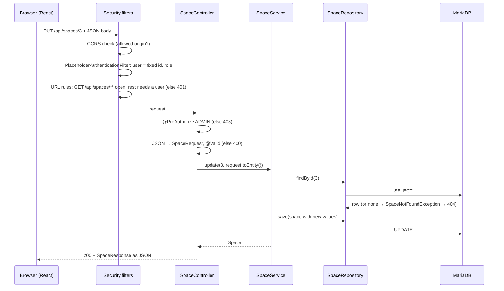
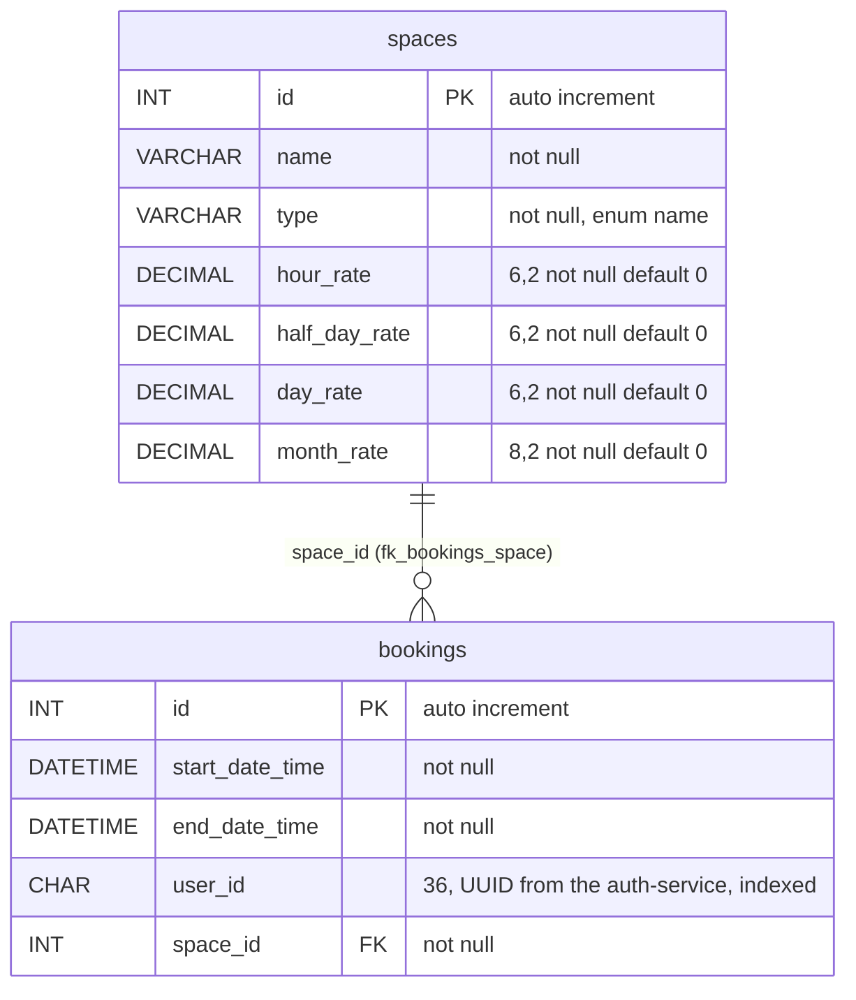

# app-service

The Spring Boot back end of Gestion Coworking (Spring Boot 4.1, Java 21, MariaDB/MySQL). It manages the spaces and searches the free ones. Bookings follow in a later plan. Users and sign-in will come from a separate auth-service; until it exists, every request runs as one fixed user.

How the spaces part was finished is described in `docs/backend-spaces-plan.md`; bookings and users get their own plans.

## Commands

Run from `backend/app-service` (Maven wrapper, no global Maven):

```powershell
.\mvnw.cmd spring-boot:run                              # run the app on http://localhost:8080
.\mvnw.cmd test                                         # all tests
.\mvnw.cmd test -Dtest=SpaceControllerTest              # one test class
.\mvnw.cmd test -Dtest=SpaceControllerTest#deleteReturns204  # one test method
```

The app and the tests need a MySQL-compatible server at `localhost:3306` with an existing database `gestion_coworking` (locally: XAMPP's MariaDB, user `root`, empty password). Flyway creates the tables on startup. If the server is not started, startup fails with "Communications link failure".

To run as another role without editing `application.properties`:

```powershell
.\mvnw.cmd spring-boot:run "-Dspring-boot.run.arguments=--app.placeholder-user-role=CLIENT"
```

`ADMIN`, `CLIENT`, or an empty value for a guest.

## Configuration

`src/main/resources/application.properties`:

| Key | Use |
| --- | --- |
| `spring.datasource.url`, `.username`, `.password` | Database connection (local values only; see `docs/to-do.md` before deploying) |
| `spring.jpa.hibernate.ddl-auto=validate` | Hibernate checks the entities against the tables but never changes the schema (Flyway does) |
| `spring.jpa.open-in-view=false` | The database session closes when the service returns; lazy relations cannot be loaded while the JSON answer is written |
| `spring.jpa.show-sql=true` | Logs SQL queries (development only) |
| `app.placeholder-user-id` | Id of the fixed user, until the auth-service exists |
| `app.placeholder-user-role` | Role of the fixed user: `ADMIN`, `CLIENT`, or empty for a guest |
| `app.cors.allowed-origins` | Front-end addresses allowed to call the API (comma-separated) |

## File structure

Java packages are under `src/main/java/io/github/cyflamant/gestioncoworking/`.

```
app-service/
├── pom.xml                         dependencies (web, JPA, validation, security, Flyway, MySQL driver)
├── src/main/java/.../gestioncoworking/
│   ├── GestionCoworkingApplication.java   entry point
│   ├── controller/                 HTTP layer: URLs, status codes, roles
│   │   ├── SpaceController.java        /api/spaces
│   │   ├── MeController.java           /api/me
│   │   └── GlobalExceptionHandler.java exceptions → ProblemDetail JSON
│   ├── dto/                        what goes over HTTP (records)
│   │   ├── SpaceRequest.java           body of POST/PUT, with validation rules
│   │   ├── SpaceResponse.java          space as sent to the front end
│   │   └── MeResponse.java             id and role of the current user
│   ├── service/                    business rules
│   │   ├── SpaceService.java
│   │   ├── SpaceNotFoundException.java
│   │   ├── SpaceHasBookingsException.java
│   │   └── InvalidSlotException.java   search slot whose end is not after its start
│   ├── repository/                 database access (Spring Data JPA)
│   │   └── SpaceRepository.java        CRUD + findAvailable (free-space search query)
│   ├── entity/                     JPA entities, mapped to the tables
│   │   ├── Space.java
│   │   └── Booking.java                only read by the free-space search so far
│   └── security/                   who is calling and what they may do
│       ├── SecurityConfig.java         filter chain, URL rules, CORS
│       ├── PlaceholderAuthenticationFilter.java  signs every request in as the fixed user
│       ├── CurrentUserProvider.java    interface: id of the current user
│       └── PlaceholderUserProvider.java  its fixed implementation
├── src/main/resources/
│   ├── application.properties
│   └── db/migration/V1__… to V6__…  Flyway migrations (the schema)
└── src/test/java/.../gestioncoworking/  same packages as main, plus integration/
```

## Layers

Each layer only calls the one below it.

| Layer | Package | Does | Does not |
| --- | --- | --- | --- |
| Security | `security/` | Sets the current user, refuses guests (401), allows CORS preflights | Know about spaces |
| Controller | `controller/` | Maps URLs, checks the role (`@PreAuthorize`), validates the body (`@Valid`), converts DTO ↔ entity, sets the status code | Hold business rules or call repositories |
| Service | `service/` | Business rules, throws domain exceptions (`SpaceNotFoundException`…) | Know about HTTP |
| Repository | `repository/` | Reads and writes the tables | Hold rules |
| Entity | `entity/` | Java image of a table row | Leave the back end: entities are never sent as JSON |

Rules on the data are checked twice: on the request (`SpaceRequest`, answered with 400) and on the entity before Hibernate saves it (`Space`).

## Data flows

### A request, from browser to database



The other space endpoints follow the same path. `GET` skips the role check, `POST` has no `findById`, and `DELETE` answers 204 with no body.

The free-space search (`GET /api/spaces/available`) reads its query parameters instead of a body: Spring converts `start` and `end` to `LocalDateTime` and `type` to `SpaceType`, `SpaceService.findAvailable` checks that the end is after the start, and `SpaceRepository.findAvailable` runs one query: the spaces of that type with no booking where `booking.start < end` and `booking.end > start`. A booking that only touches the slot does not block it.

### Objects along the way

```
JSON body ──Jackson──▶ SpaceRequest ──toEntity()──▶ Space ──▶ SpaceService ──▶ SpaceRepository ──▶ table spaces
JSON answer ◀──Jackson── SpaceResponse ◀──from()── Space ◀──────────────────────────────────────────┘
```

`SpaceResponse` has no `bookings` field, so the bookings of a space are never loaded or sent.

### Errors

A service or Spring exception goes up to `GlobalExceptionHandler`, which answers a `ProblemDetail` JSON (`status`, `title`, `detail`, `instance`, and `errors` for invalid fields):

| Cause | Status | `detail` | `errors` |
| --- | --- | --- | --- |
| Invalid field (`@Valid`) | 400 | `Données invalides` | `{ "name": "Champ obligatoire" }` (first message per field) |
| Value of the wrong type or unknown enum | 400 | `Données invalides` | `{ "type": "Valeur invalide" }` |
| Body is not valid JSON | 400 | `Format JSON invalide` | none |
| Missing query parameter | 400 | `Données invalides` | `{ "start": "Champ obligatoire" }` |
| Query parameter of the wrong type (bad date, unknown type) | 400 | `Données invalides` | `{ "start": "Valeur invalide" }` |
| `InvalidSlotException` (end not after start) | 400 | `Données invalides` | `{ "end": "La fin doit être après le début" }` |
| No user (guest) on a protected URL | 401 | empty body | none |
| Wrong role (`@PreAuthorize`) | 403 | `Accès refusé` | none |
| `SpaceNotFoundException` | 404 | `Espace introuvable : 99` | none |
| `SpaceHasBookingsException` | 409 | `Impossible de supprimer l'espace 1 : il a des réservations` | none |

User-facing messages are in French.

## Security

- **Current user:** `PlaceholderAuthenticationFilter` signs every request in as `app.placeholder-user-id` with `app.placeholder-user-role`. If the role is empty, the request stays anonymous (guest). A user already set, e.g. by `@WithMockUser` in tests, is kept. The auth-service will replace this filter with a JWT check. `CurrentUserProvider` gives the same id to code that needs it (bookings).
- **URL rules:** `GET /api/spaces/**` is open to everyone, including guests. Everything else needs a user (401 otherwise).
- **Role rules:** creating, updating and deleting a space need `ADMIN` (403 otherwise).
- **CORS:** origins from `app.cors.allowed-origins`; methods `GET POST PUT DELETE OPTIONS`; headers `Content-Type` and `Authorization` (for the future JWT).
- **Stateless:** no session and no CSRF token, since the API is JSON only and will carry a JWT.

## Endpoints

| Method and path | Role | Body | Answer |
| --- | --- | --- | --- |
| `GET /api/spaces` | everyone | none | 200, list of spaces |
| `GET /api/spaces/available?start=&end=&type=` | everyone | none | 200, free spaces between `start` and `end` (ISO local date-times, e.g. `2026-12-01T09:00:00`), of one `type` or all; 400 |
| `GET /api/spaces/{id}` | everyone | none | 200, one space; 404 |
| `POST /api/spaces` | ADMIN | space | 201, created space; 400, 403 |
| `PUT /api/spaces/{id}` | ADMIN | space | 200, updated space; 400, 403, 404 |
| `DELETE /api/spaces/{id}` | ADMIN | none | 204; 403, 404, 409 if it has bookings |
| `GET /api/me` | any user | none | 200, `{ id, role }`; 401 for a guest |

A space in JSON (an `id` sent in a request body is ignored):

```json
{ "id": 1, "name": "Salle Meuse", "type": "ROOM",
  "hourRate": 15.00, "halfDayRate": 50.00, "dayRate": 90.00, "monthRate": 1500.00 }
```

`type` is `OPENSPACE`, `OFFICE` or `ROOM`. Rates are numbers ≥ 0, and a rate of 0 means the formula is free.

## Database

Flyway owns the schema. Hibernate only validates it (`ddl-auto=validate`), so every schema change needs a new migration and the matching entity change, or startup fails. Never edit an applied migration.



`bookings.user_id` has no foreign key: users live in the auth-service's own database. The foreign key `fk_bookings_space` prevents deleting a space that has bookings.

| Migration | Change |
| --- | --- |
| `V1__init.sql` | Table `spaces` (id, name, type) |
| `V2__init.sql` | Hourly, half-day and day rates |
| `V3__init.sql` | Table `bookings` (id, start, end) |
| `V4__add_user_and_space_to_bookings.sql` | `user_id` (indexed) and `space_id` with its foreign key |
| `V5__make_space_name_and_type_not_null.sql` | Name and type required |
| `V6__add_month_rate_to_spaces.sql` | Monthly rate |

## Tests

| Kind | Annotation | Database | Files |
| --- | --- | --- | --- |
| Entity validation | none (plain Validator) | no | `entity/SpaceValidationTest` |
| Service | `@ExtendWith(MockitoExtension.class)`, repository mocked | no | `service/SpaceServiceTest` |
| Repository | `@DataJpaTest` on the real MariaDB, rolled back | yes | `repository/SpaceRepositoryTest` |
| Controller | `@WebMvcTest` + `SecurityConfig`, service mocked, `@WithMockUser` for the role | no | `controller/*Test`, `security/CorsConfigTest` |
| Whole app | `@SpringBootTest` (+ MockMvc), rolled back | yes | `GestionCoworkingApplicationTests`, `integration/SpaceApiIntegrationTest` |

Every test is described in `docs/test-lists/gestion-coworking-back-end-tests.md`, with the test method names in `…-back-end-test-functions.md`.

## Official documentation

- [Spring Boot reference](https://docs.spring.io/spring-boot/4.1.1/reference/)
- [Spring Data JPA](https://docs.spring.io/spring-boot/4.1.1/reference/data/sql.html#data.sql.jpa-and-spring-data)
- [Flyway with Spring Boot](https://docs.spring.io/spring-boot/4.1.1/how-to/data-initialization.html#howto.data-initialization.migration-tool.flyway)
- [Validation](https://docs.spring.io/spring-boot/4.1.1/reference/io/validation.html)
- [Spring Security reference](https://docs.spring.io/spring-security/reference/)
- [Spring Boot Maven plugin](https://docs.spring.io/spring-boot/4.1.1/maven-plugin)
